<div align="center">

# NucSeg3D

### What volumetric fine-tuning adds to a 2D foundation model for 3D nucleus segmentation

Code, benchmark splits and leakage audit for the manuscript by<br>
Xiaoyan Li, Juanjuan Ye, Liwen Xu, Cuicui Jiang and Jiaoping Chen

<a href="#citation"></a>


<br>

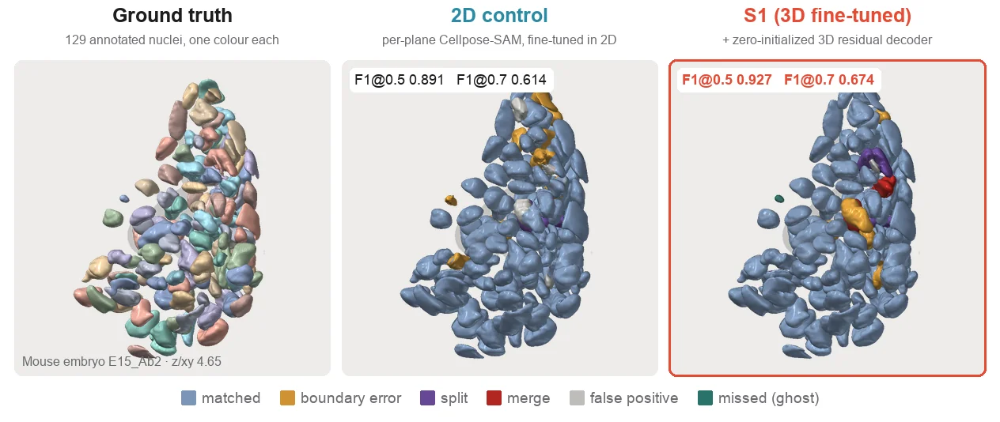

<sub><b>One test volume, three segmentations.</b> Mouse embryo E15_Ab2 (z/xy 4.65), the Fig. 2e volume chosen by the pre-specified median rule; seed 0, gt protocol.
Predicted nuclei are coloured by error class against the ground truth; numbers are the per-volume F1 reported in Fig. 6.</sub>

</div>

---

**S1** turns Cellpose-SAM, a 2D cell-segmentation foundation model, into a native 3D model. The fine-tuned ViT-L encoder is applied to every plane, and a new 3D residual decoder mixes the plane features across depth. Its output convolution is initialized to zero, so at the start of training S1 *is* the 2D model (with zero axial flow) and learns only what the third dimension adds. We compare it with the honest baseline, **2D fine-tuning on exactly the same data**, on a 13-dataset benchmark in which every test volume was audited for overlap with the training data.

## At a glance

<table>
<tr>
<td width="50%" valign="top" align="center">
<h3>227</h3>
<sub>test volumes from <b>13</b> public datasets, each compared with all training and validation volumes. <b>100</b> unrelated volumes form the clean subset C1.</sub>
</td>
<td width="50%" valign="top" align="center">
<h3>+0.037</h3>
<sub>F1@0.7 of S1 over 2D fine-tuning on data types seen in training (12 datasets, primary full-pipeline protocol; <b>+0.0374 ± 0.0086</b> over five seeds, confirmed).</sub>
</td>
</tr>
<tr>
<td width="50%" valign="top" align="center">
<h3>0.313 → 0.542 → 0.579</h3>
<sub>macro F1@0.7: original Cellpose-SAM → 2D control → S1. Most of the gain over the original model comes from 2D fine-tuning.</sub>
</td>
<td width="50%" valign="top" align="center">
<h3>≈ nnU-Net</h3>
<sub>a five-fold nnU-Net ensemble trained on the same data performed comparably: slightly behind S1 at IoU 0.5, level or slightly ahead at 0.7.</sub>
</td>
</tr>
</table>

> [!IMPORTANT]
> **What the paper does not claim.** At IoU 0.5 the gain (+0.0154 ± 0.0080, full pipeline, 12 datasets) narrowly missed its pre-specified confirmation rule, and intervals allowing for between-dataset variation included zero. Re-run with the voxel sizes stated by the data sources (post hoc), the gain held overall but disappeared on the four datasets whose voxel sizes had been estimated or assumed. On three dataset types **withheld from training**, the 3D model fell behind 2D fine-tuning at IoU 0.7 (−0.015), mainly on NucVerse3D. We do not claim that S1 outperforms native 3D architectures.

## Contents

[Method](#method) · [3D gallery](#3d-gallery) · [Results](#results) · [Benchmark and leakage audit](#benchmark-and-leakage-audit) · [Interactive viewer](#interactive-3d-viewer) · [Repository layout](#repository-layout) · [Installation](#installation) · [Reproducing](#reproducing-the-results-overview) · [Data and weights](#data-and-weights) · [Citation](#citation)

## Method

<p align="center">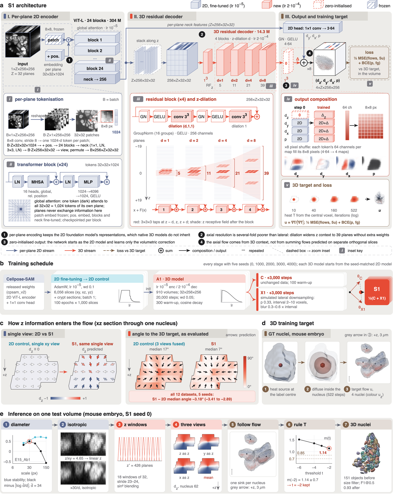</p>

<sub><b>Fig. 1 | S1: a native 3D decoder grown from a 2D foundation model.</b> <b>a</b>, The fine-tuned Cellpose-SAM encoder (ViT-L, 304 million parameters; only the 8×8 patch embedding is frozen) is applied to every plane with shared weights; a new 3D residual decoder (14.3 million parameters; four residual blocks dilated along z by 1, 2, 4 and 8) mixes the stacked plane features. A zero-initialized output convolution adds a correction Δ to the per-plane 2D head and alone gives the axial flow d<sub>z</sub>, so at step 0 the network equals the 2D control. <b>b</b>, Training schedule: 2D fine-tuning gives the 2D control; the 3D model starts from it; two copies (one with simulated lateral downsampling) are trained further and averaged into S1 (a model soup). <b>c</b>, How z information enters the flow. <b>d</b>, The 3D training target (heat diffusion inside each annotated nucleus). <b>e</b>, Inference on one test volume.</sub>

The model is built in three steps:

1. **2D fine-tuning.** Cellpose-SAM is fine-tuned on 2D slices of the training volumes. This gives the *2D control*, which is also the starting point of the 3D model.
2. **Volumetric fine-tuning.** The encoder runs on every slice; a 3D residual decoder mixes slice features across depth and outputs axial and lateral flows and the foreground probability. Its output layer starts at zero, so everything it adds is learned from 3D targets, Cellpose flows computed in 3D by simulating diffusion inside each annotated nucleus. The encoder (all but its patch embedding) keeps training.
3. **Robustness to coarse lateral sampling.** Two copies are trained further, on unchanged data and with simulated lateral downsampling, and their parameters are averaged with a fixed weight of 0.5.

At inference, volumes with z/xy ≥ 2 are interpolated to an isotropic grid and the flows are followed there (*isotropic flow following*); a threshold rule (*rule T*) lowers the foreground threshold when predicted nuclei are too small, applied identically to S1 and the 2D control; and the model is run on three orientations and averaged, except for Cellos, *Parhyale* and mesoSPIM (the *view rule*).

## 3D gallery

<p align="center">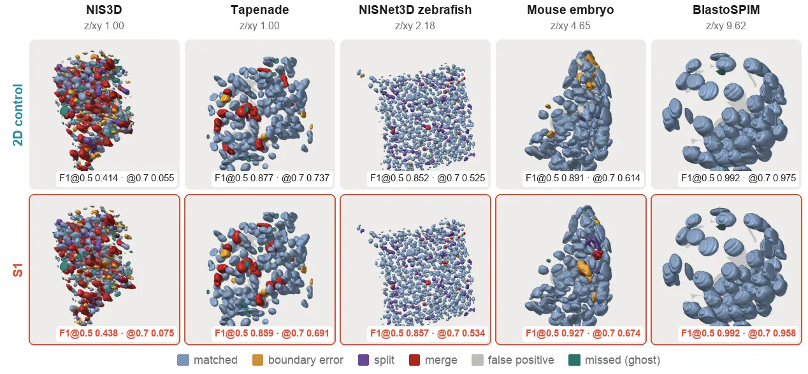</p>

<sub><b>Fig. 2e, in motion.</b> For five of the 12 pooled datasets at evenly spaced ranks of z/xy, the test volume whose S1 − 2D F1@0.5 is closest to the dataset median (pre-specified median rule; seed 0, gt protocol). Top, 2D control; bottom, S1 (framed). Missed ground-truth nuclei are drawn as ghosts. Per-volume F1 values as in Fig. 2e and Fig. 6. These volumes were chosen by a rule, not for appearance: by F1@0.5, S1 is higher on three, equal on BlastoSPIM and lower on Tapenade.</sub>

<details>
<summary><b>Per-volume numbers of the gallery</b> (gt protocol, seed 0; same values as Fig. 6)</summary>

| Dataset | Test volume | z/xy | 2D control F1@0.5 / F1@0.7 | S1 F1@0.5 / F1@0.7 |
|---|---|---:|---:|---:|
| NIS3D | Zebrafish_2_xR25 | 1.00 | 0.414&nbsp;/&nbsp;0.055 | 0.438&nbsp;/&nbsp;0.075 |
| Tapenade | annotator2_square13 | 1.00 | 0.877&nbsp;/&nbsp;0.737 | 0.859&nbsp;/&nbsp;0.691 |
| NISNet3D zebrafish | Embryo3_0256_0128 | 2.18 | 0.852&nbsp;/&nbsp;0.525 | 0.857&nbsp;/&nbsp;0.534 |
| Mouse embryo | E15_Ab2 | 4.65 | 0.891&nbsp;/&nbsp;0.614 | 0.927&nbsp;/&nbsp;0.674 |
| BlastoSPIM | BlastoSPIM1_test_modSNR_F40_136_image_0001 | 9.62 | 0.992&nbsp;/&nbsp;0.975 | 0.992&nbsp;/&nbsp;0.958 |

</details>

<details>
<summary><b>Orthogonal sections of all 13 datasets</b> (Supplementary Figure)</summary>
<br>
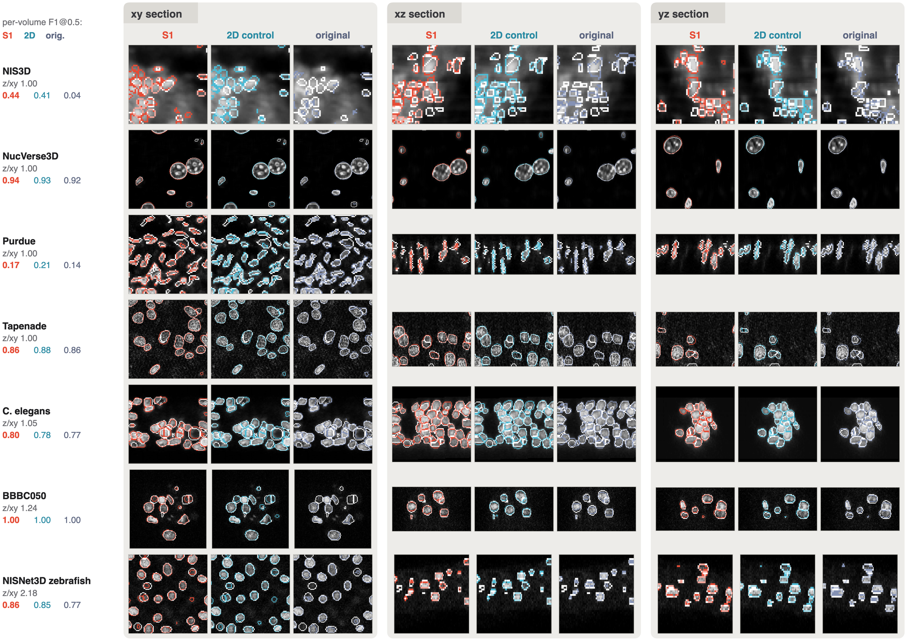
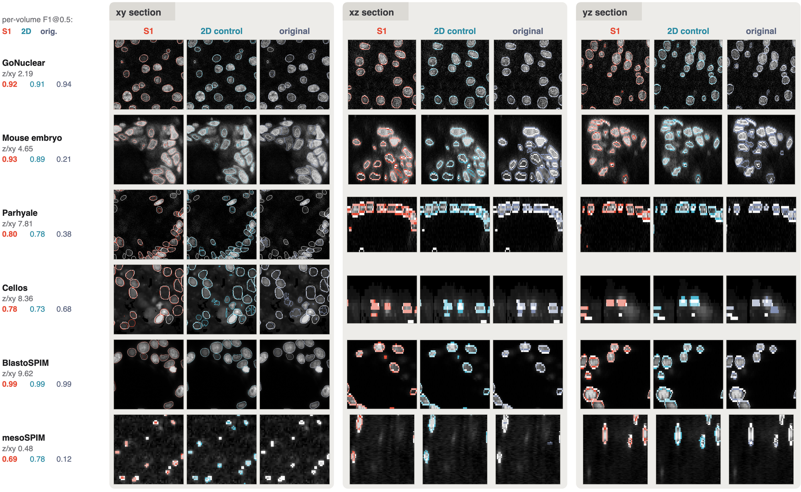
</details>

## Results

### Main results on data types seen in training

Macro-averaged F1@0.5 / F1@0.7 (mean of five seeds; the original model has one). Δ is the paired S1 − 2D difference, mean ± s.d. over five seeds; ✓ marks differences that pass the pre-specified confirmation rule (mean > 2 s.d. and ≥ 0.01). The full pipeline was pre-specified as the primary protocol. (Table 2 of the manuscript.)

| Datasets (volumes) | Original | 2D control | **S1** | Δ F1@0.5 | Δ F1@0.7 |
|---|:---:|:---:|:---:|:---:|:---:|
| ***Full pipeline (primary)*** | | | | | |
| 12 (44) | 0.615&nbsp;/&nbsp;0.313 | 0.770&nbsp;/&nbsp;0.542 | **0.785&nbsp;/&nbsp;0.579** | +0.0154&nbsp;±&nbsp;0.0080 | **+0.0374&nbsp;±&nbsp;0.0086&nbsp;✓** |
| 13 (45) | 0.577&nbsp;/&nbsp;0.289 | 0.762&nbsp;/&nbsp;0.511 | **0.772&nbsp;/&nbsp;0.547** | +0.0107&nbsp;±&nbsp;0.0147 | **+0.0354&nbsp;±&nbsp;0.0144&nbsp;✓** |
| C1: 8 (27) | 0.737&nbsp;/&nbsp;0.379 | 0.828&nbsp;/&nbsp;0.594 | **0.849&nbsp;/&nbsp;0.639** | +0.0213&nbsp;±&nbsp;0.0031&nbsp;✓ | **+0.0449&nbsp;±&nbsp;0.0054&nbsp;✓** |
| ***gt protocol*** | | | | | |
| 12 (226) | 0.628&nbsp;/&nbsp;0.327 | 0.773&nbsp;/&nbsp;0.543 | **0.791&nbsp;/&nbsp;0.581** | +0.0180&nbsp;±&nbsp;0.0032&nbsp;✓ | **+0.0377&nbsp;±&nbsp;0.0027&nbsp;✓** |
| 13 (227) | 0.589&nbsp;/&nbsp;0.302 | 0.772&nbsp;/&nbsp;0.515 | **0.783&nbsp;/&nbsp;0.552** | +0.0116&nbsp;±&nbsp;0.0040&nbsp;✓ | **+0.0370&nbsp;±&nbsp;0.0072&nbsp;✓** |
| C1: 8 (100) | 0.720&nbsp;/&nbsp;0.387 | 0.828&nbsp;/&nbsp;0.595 | **0.853&nbsp;/&nbsp;0.645** | +0.0250&nbsp;±&nbsp;0.0030&nbsp;✓ | **+0.0505&nbsp;±&nbsp;0.0031&nbsp;✓** |

<sub>12 = all datasets except mesoSPIM (a single out-of-domain test volume); C1 = clean subset of test volumes with no detectable relationship to the training data. The full-pipeline protocol estimates diameters automatically on up to four volumes per dataset; the gt protocol supplies the annotated median diameter and uses all 227 volumes.</sub>

<p align="center">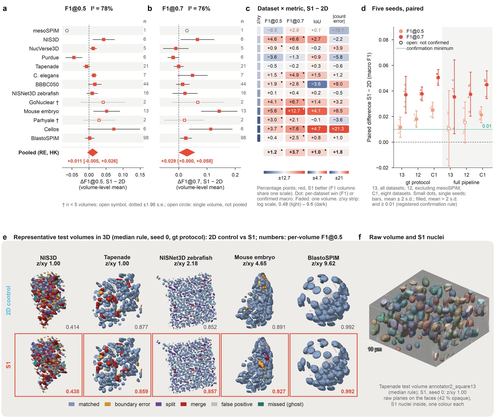</p>

<sub><b>Fig. 2 | Comparison with 2D fine-tuning on the same data.</b> <b>a</b>, <b>b</b>, Per-dataset differences S1 − 2D in F1@0.5 and F1@0.7 (gt protocol) with the random-effects estimate (Hartung–Knapp interval). <b>c</b>, Dataset × metric summary. <b>d</b>, Paired macro-F1 differences for the five seeds by protocol and subset. <b>e</b>, Representative test volumes in 3D (animated above). <b>f</b>, The Tapenade volume of <b>e</b>: raw planes on the faces and S1 nuclei inside.</sub>

### Where the gain comes from

The 3D model was expected to work mainly by preventing nuclei from being cut along z. It did not: it mainly reduced **boundary errors** and **false detections**. The total error 1 − F1@0.5 fell from 0.227 (2D control) to 0.209 (S1), mostly through fewer inaccurate boundaries (−0.0087) and fewer false positives (−0.0074); nuclei cut along z were rare (0.53% for S1, 0.57% for the 2D control). The difference between S1 and the 2D control was +0.018 at IoU 0.5 and +0.032 to +0.038 between IoU 0.60 and 0.75, so the gain lies mostly in matching above IoU 0.6. An encoder-only control shows that the gain is shared between the jointly retrained encoder and the decoder (on the ten three-orientation datasets, gt protocol: +0.020 of +0.036 F1@0.7 from the encoder, +0.016 from the decoder).

<p align="center">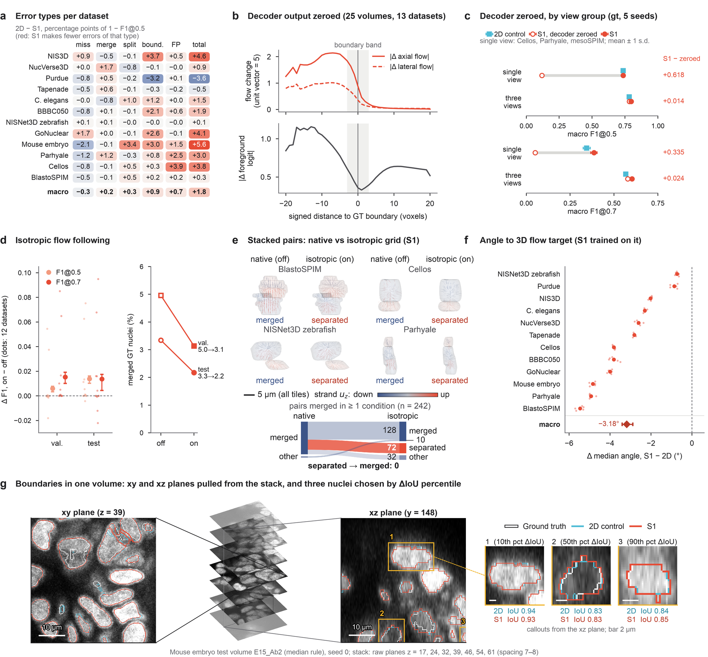</p>

<sub><b>Fig. 3 | Where the gain comes from.</b> <b>a</b>, Reduction in error per dataset and error type. <b>b</b>, <b>c</b>, Decoder output zeroed. <b>d</b>, <b>e</b>, Isotropic flow following on versus off and touching nuclei merged on the native grid. <b>f</b>, Agreement with the GT-derived 3D flow target (post hoc). <b>g</b>, Boundaries in the Fig. 2e mouse-embryo volume.</sub>

<details>
<summary><b>Fig. 4 | Axial subsampling and noise</b> — the F1@0.7 advantage grows at coarse sampling but is lost under added noise</summary>
<br>

Keeping every *k*th plane of 20 nearly isotropic test volumes from six datasets, S1's F1@0.7 advantage over the 2D control was +0.024 at full sampling, +0.072 at *k* = 4 and +0.052 at *k* = 8, while F1@0.5 differences stayed between +0.002 and +0.010. With added Gaussian noise the advantage disappeared; at the higher noise level S1 was worse even at full sampling (F1@0.7 −0.020, all seeds negative). Training used no noise augmentation.

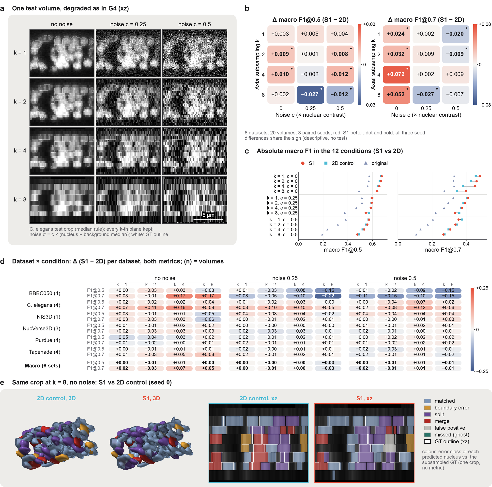
</details>

### Datasets withheld from training

Macro over BBBC050, BlastoSPIM and NucVerse3D of pooled F1@0.5 / F1@0.7 with rule T, mean of three seeds (0, 1000, 2000). Retrained models never saw these datasets; production models did. Δ is the paired 3D − 2D difference (mean ± s.d.); ✓ confirmed advantage, ✗ confirmed deficit, n.c. not confirmed in either direction. (Table 3 of the manuscript.)

| Protocol (volumes) | Models | 3D/2D, F1@0.5; F1@0.7 | Δ F1@0.5 | Δ F1@0.7 |
|---|---|:---:|:---:|:---:|
| gt (147) | retrained | 0.880/0.886; 0.689/0.704 | −0.007&nbsp;±&nbsp;0.005&nbsp;n.c. | **−0.015&nbsp;±&nbsp;0.004&nbsp;✗** |
| gt (147) | production | 0.913/0.903; 0.773/0.754 | +0.0096&nbsp;±&nbsp;0.003&nbsp;n.c. | +0.019&nbsp;±&nbsp;0.010&nbsp;n.c. |
| Full pipeline (12) | retrained | 0.809/0.850; 0.619/0.645 | **−0.040&nbsp;±&nbsp;0.012&nbsp;✗** | −0.026&nbsp;±&nbsp;0.018&nbsp;n.c. |
| Full pipeline (12) | production | 0.879/0.875; 0.715/0.692 | +0.004&nbsp;±&nbsp;0.005&nbsp;n.c. | +0.023&nbsp;±&nbsp;0.012&nbsp;n.c. |

Only NucVerse3D showed a confirmed deficit at F1@0.7 (−0.068), and it accounts for the macro deficit. In an exploratory single-seed experiment, adding back five to ten training volumes of each held-out dataset recovered most of the F1@0.7 loss on BBBC050 and NucVerse3D and about half on BlastoSPIM.

<p align="center">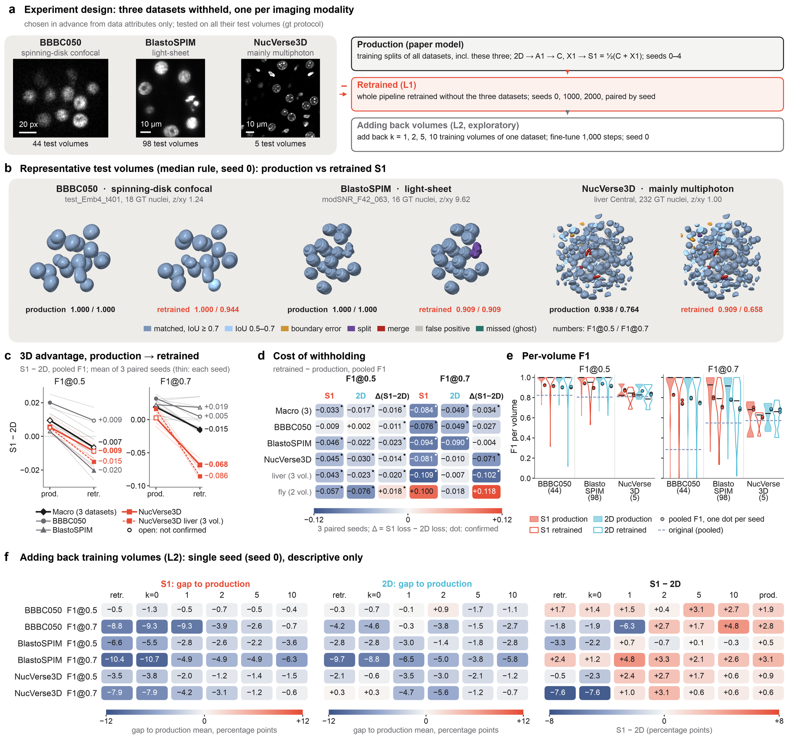</p>

<sub><b>Fig. 5 | Datasets withheld from training.</b> <b>a</b>, Design: one dataset per imaging modality, chosen in advance from data attributes only, removed and the whole pipeline retrained. <b>b</b>, Representative test volumes, production and retrained S1. <b>c</b>, The 3D advantage S1 − 2D in production and retrained models. <b>d</b>, Cost of withholding. <b>e</b>, Per-volume F1. <b>f</b>, Adding back training volumes (single seed, exploratory).</sub>

### Comparison with other tools

nnU-Net and StarDist-3D were trained on the same 910 training volumes, tuned on the validation set and run on our resampled grid with the same diameters as S1. Our conclusions rest on the stronger nnU-Net variant, the five-fold ensemble (added post hoc).

| Comparison (from the Results text) | Value |
|---|---|
| S1 − nnU-Net 5-fold ensemble, F1@0.5 | +0.011 to +0.036, confirmed in all six protocol × subset combinations |
| S1 − nnU-Net 5-fold ensemble, F1@0.7 (gt, 13 datasets) | −0.015, ensemble confirmed better (S1 0.552, ensemble 0.568); other F1@0.7 differences not confirmed or with bootstrap intervals including zero |
| Datasets where the ensemble had the higher point estimate (gt) | 7 of 13 at F1@0.5, 8 of 13 at F1@0.7 |
| S1 vs StarDist-3D | S1 better under every protocol and subset |
| Three published 3D tools, as released (44 volumes) | macro F1@0.5 0.301 to 0.604, versus 0.767 for S1 |
| Median time per volume, 45 full-pipeline volumes (RTX 5090) | nnU-Net single fold 18.7 s · StarDist-3D 37.1 s · S1 with rule T 61.5 s (46.0 s at a fixed threshold) · nnU-Net 5-fold 74.8 s (separate session) |
| Peak GPU memory of S1 | 4.2 GiB |

S1's average detection advantage over the ensemble rests largely on *Parhyale* and the strongly anisotropic Cellos, where resampling to our grid may particularly disadvantage nnU-Net.

<p align="center">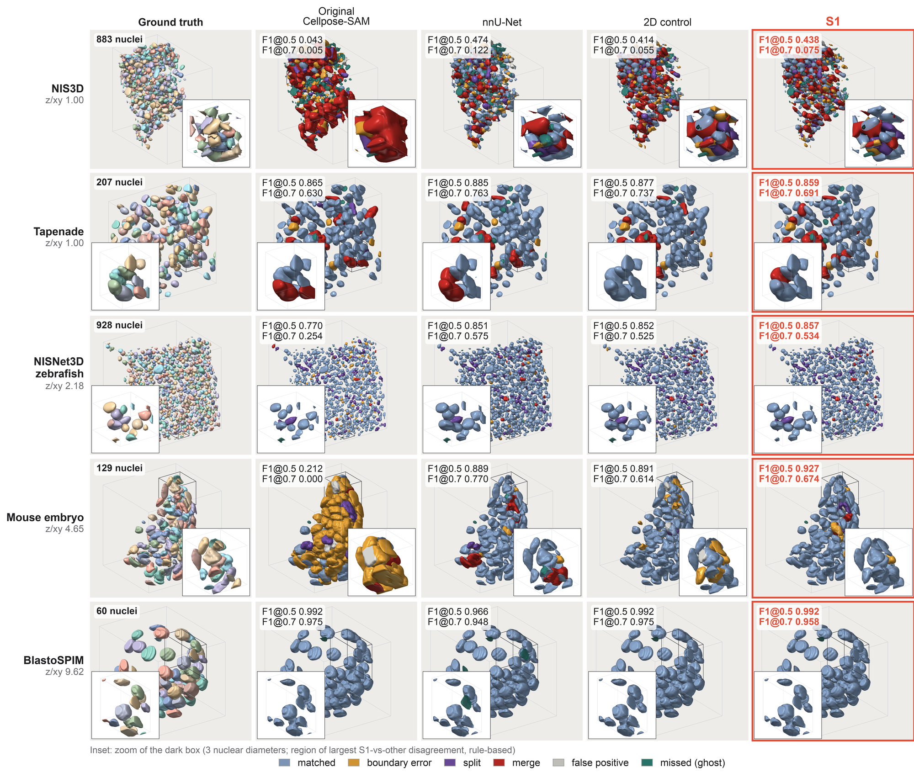</p>

<sub><b>Fig. 6 | The same volumes segmented by five methods.</b> Rows, the five median-rule volumes of Fig. 2e; columns, ground truth, the original Cellpose-SAM, nnU-Net (single fold), the 2D control and S1 (framed). Insets zoom into the window of largest S1-versus-other disagreement, chosen by a rule fixed before rendering. The volumes were chosen by the S1 − 2D rule and are not representative of the S1 − nnU-Net comparison; the tiles illustrate error types and are not a basis for ranking.</sub>

<p align="center">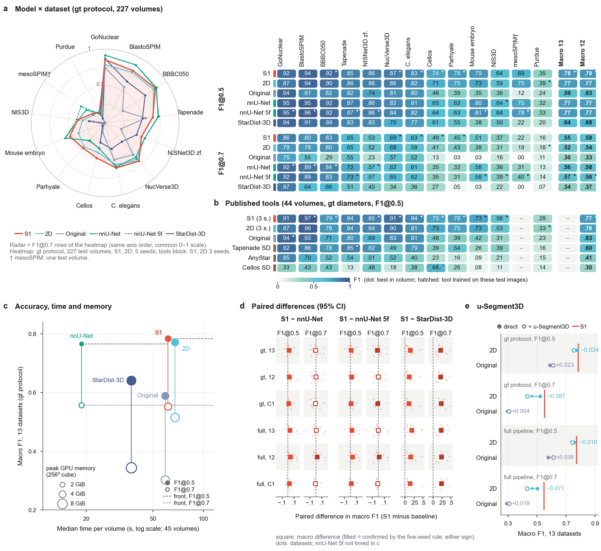</p>

<sub><b>Fig. 7 | Comparison with other tools.</b> <b>a</b>, Model × dataset heat maps of pooled F1@0.5 and F1@0.7 (gt protocol, 227 test volumes). <b>b</b>, Published tools on 44 full-pipeline test volumes. <b>c</b>, Accuracy against inference cost on one GPU. <b>d</b>, S1 − nnU-Net (single fold and five-fold ensemble) and S1 − StarDist-3D by protocol and subset. <b>e</b>, Consensus 3D reconstruction (u-Segment3D) versus direct inference.</sub>

## Benchmark and leakage audit

Thirteen public fluorescence datasets with 3D annotations of individual nuclei: embryos of mouse, *C. elegans*, zebrafish and *Parhyale*, plant ovules, organoids, liver and kidney tissue, and whole-brain light-sheet data. The 3D model was trained on 910 volumes (88,422 nuclei) from 12 of these datasets and one training-only dataset; all modelling choices were made on 88 validation volumes; the 227 test volumes were used only to report results.

Before computing any score, every test volume was compared with all training and validation volumes:

| Relationship to training material | Test volumes |
|---|---:|
| Identical to, containing or contained in training material | 8 |
| Separate parts of specimens seen in training (mesoSPIM: in validation and development) | 13 |
| Belonging to time series used in training | 106 |
| No detectable relationship (**clean subset C1**, eight datasets) | **100** |

All 227 volumes stayed in the test set; every comparison is reported both on all test volumes and on C1 (C2 = C1 plus the 13 separate-specimen volumes).

<details>
<summary><b>Table 1 | Datasets</b> (volumes per split)</summary>
<br>

| Dataset | Modality | Train | Val | Test | C1 |
|---|---|---:|---:|---:|---:|
| BBBC050 | spinning-disk confocal | 110 | 11 | 44 | 44 |
| BlastoSPIM | light-sheet | 520 | 35 | 98 | 8 |
| *C. elegans* | confocal | 18 | 3 | 7 | 7 |
| Cellos | confocal | 26 | 4 | 6 | 6 |
| GoNuclear | confocal | 6 | 2 | 2 | 2 |
| mesoSPIM | light-sheet (mesoSPIM) | 0 | 1 | 1 | 0 |
| Mouse embryo | confocal | 19 | 3 | 13 | 12 |
| NIS3D | light-sheet | 5 | 1 | 6 | 0 |
| NISNet3D zebrafish | confocal | 50 | 7 | 16 | 16 |
| NucVerse3D | multiphoton / confocal | 15 | 2 | 5 | 5 |
| *Parhyale* | confocal | 3 | 1 | 2 | 0 |
| Purdue | confocal / multiphoton | 20 | 3 | 6 | 0 |
| Tapenade | two-photon | 114 | 15 | 21 | 0 |
| **Total** | | **906** | **88** | **227** | **100** |

<sub>The 3D training set also contains four volumes of a training-only dataset (not shown). Of the NISNet3D zebrafish embryos, Embryos 1 and 2 provide the training and validation volumes and Embryo 3 the test volumes; all 16 test volumes are lateral tiles of this one embryo. Sources and licences of each dataset are listed in the manuscript.</sub>
</details>

<details>
<summary><b>Known weak spots</b> (stated in the manuscript)</summary>
<br>

- On **Purdue**, whose annotations merge touching nuclei in 26 of 29 volumes, gt F1@0.5 was 0.352 for S1 versus 0.388 for the 2D control.
- On the single out-of-domain **mesoSPIM** test volume, S1 scored 0.687 versus 0.752 (gt F1@0.5); rule T was designed on development volumes from the same brain, so mesoSPIM is not an independent out-of-domain test.
- Under **added noise**, which training did not simulate, the advantage vanished.
- **Voxel sizes** for four datasets were estimated or assumed; re-running with the source values removed the F1@0.7 gain on those four datasets (+0.021 to −0.001), driven by BBBC050 and NISNet3D zebrafish.
- The test set was used repeatedly (three successive model versions and 29 additional analyses, 20 of them added or changed post hoc); the full analysis history is in the Supplementary Information.
</details>

## Interactive 3D viewer

<a href="docs/Supplementary_Data_3D_viewer.html">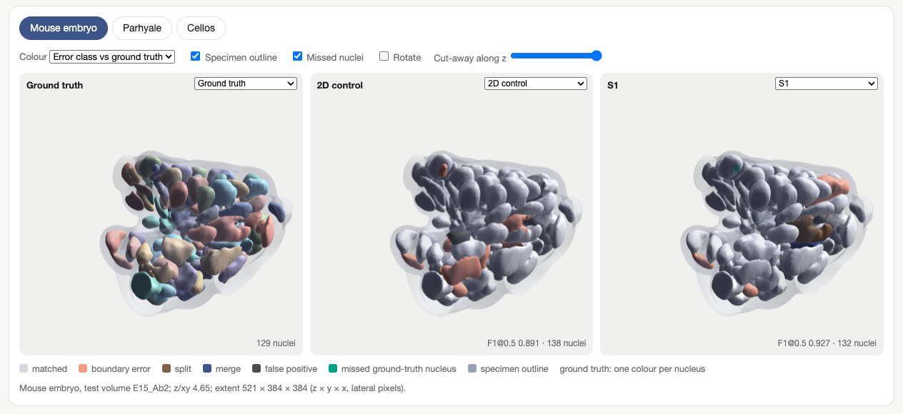</a>

[`docs/Supplementary_Data_3D_viewer.html`](docs/Supplementary_Data_3D_viewer.html) (22 MB, self-contained, works offline) is the Supplementary Data viewer of the manuscript: three synchronized panes (ground truth, 2D control, S1, or any model per pane) for the mouse-embryo, *Parhyale* and Cellos test volumes, with error-class colouring, specimen outline, missed nuclei and a z cut-away. GitHub does not render HTML pages, so **download the file and open it in a browser**. The screenshot above is the viewer as shipped.

## Repository layout

Most comments, docstrings and log messages in the code are in Chinese, because the project was developed in Chinese. Function and variable names, command-line options and file formats are in English. `docs/` holds the images of this page and the interactive 3D viewer.

| Folder | Files | Contents |
|---|---|---|
| `src/` | 49 | Core package (flat modules that import each other by name): data registry and standardisation, slice and isotropic-volume generation, 2D control training, 3D network, 3D training, weight averaging, inference, evaluation, rule T, and the GPU follow-up evaluations. |
| `orx_run.py`, `run.sh`, `val_split.json`, `mesospim_*.json`, `configs/` | 6 | Experiment driver used for every training and evaluation run (each run was one `config.json`; one real example is in `configs/`), and the fixed validation split. |
| `data_prep/` | 3 | Download scripts for the public source datasets (URLs of the original repositories). |
| `audit/` | 5 | Train–test leakage audit (template matching and identity checks against every training volume) and the independent spot check. |
| `baselines/` | 24 | nnU-Net v2 (single fold and five-fold), StarDist-3D, conversion to their formats, timing (G5), evaluation and paired statistics against S1. |
| `analysis/stats/` | 17 | Five-seed statistics: paired seed differences, confirmation rule, mixed models, meta-analysis and meta-regression, covariates, Bland–Altman, reviewer-round analyses (`round3/`). |
| `analysis/five_seed/` | 8 | Five-seed result aggregation (`s5_stats.py`, `test_r6.py`) that the statistics build on, rule-T decision, Purdue tolerant-split analysis. |
| `analysis/errors/` | 9 | Error decomposition (miss, merge, split, boundary, false), boundary metrics, F1–IoU curves. |
| `analysis/flowerr/` | 5 | Angle between predicted and ground-truth-derived 3D flows. |
| `analysis/cpu_extra/` | 9 | Morphology bias tests and depth / local-SNR stratification (CPUX). |
| `analysis/followups/` | 33 | Follow-up analyses G1 (published tools), G3 (u-Segment3D), G4 (anisotropy degradation), G6, M1, A3–A5 (calibration, decoder residual, feature distance), VOX/VOX2 (source voxel sizes), EO (encoder-only control); `jobs/` holds the job definitions with the exact command lines. |
| `analysis/heldout/` | 17 | Held-out dataset experiments L1–L3 (retraining without a dataset, few-shot, estimated diameters). |
| `analysis/methods/` | 1 | Crop-window counts reported in Methods. |
| `analysis/development/` | 31 | Development-stage selection scripts (rounds 4–6: paired screening and confirmation, soup checks, diagnostics) and the ground-truth boundary-convention check. These produced the development history in the Supplementary Information. |
| `analysis/figure_exports/` | 9 | Server-side exports of volumes, flows and renderings used by the figure scripts. |
| `tests/round6/` | 19 | Equivalence and unit tests written during development (for example, that the zero-initialised decoder reproduces the 2D model exactly). |
| `paper/scripts/`, `paper/figures/` | 94 | Figure, table and source-data generators (final versions and the modules they import). The folder mirrors the manuscript folder so relative paths inside the scripts work. |

### Method components and where they are

| Component (paper term) | Code |
|---|---|
| 2D control (2D fine-tuning of Cellpose-SAM on xy and isotropic xz/yz slices) | `src/make_slices_std.py`, `src/make_slices_flow3d.py` (slices and flow targets), `src/train_cpsam2.py` (training) |
| 3D network: per-slice encoder + zero-initialised residual 3D decoder (variant `dec3d`) | `src/net3d.py` (`Dec3D`, `ResBlock3D`, output layer initialised to zero) |
| 3D training (A1, then C and X1 continuations; anisotropy simulation options `--aniso_*`) | `src/train3d.py`, `src/data3d.py` (patches from the isotropic store built by `src/make_iso_vols.py`) |
| Model soup S1 = ½(C + X1), α fixed at 0.5 | `src/avg_weights.py` (round 5) and `src/avg_weights_r6.py` (same averaging, later seeds) |
| Inference, three-view averaging and the view rule (`--views 3 --views1_ds cellos parhyale mesospim`) | `src/infer3d.py`, `src/eval_gt.py` |
| Isotropic flow following (interpolate z to an isotropic grid, follow flows there, return to the original planes) | `src/eval_gt.py` (uses `zinterp` from `src/eval_val.py`) |
| Rule T (scale-consistent foreground threshold) | `src/sizeThr_dir.py`, `src/thr_eval.py` |
| Automatic diameter search used by the primary (full-pipeline) protocol | `src/eval_val.py` (`r2a2` joint rule), passed to `eval_gt.py --diam_from` |
| gt protocol (annotated diameters) and full pipeline evaluation; F1 at IoU 0.5 / 0.7 | `src/eval_gt.py`, `src/metrics.py` |
| E3 three-seed ensemble | `src/ens_exact.py`, `src/ens_test.py` |
| Benchmark construction (13 datasets, standard format, voxel sizes) | `src/cpft_data.py`, `src/cpft_data_b3.py`, `src/standardize.py`, `src/fix_std*.py`, `src/merge_b3.py`, `src/stddata.py`, `src/val_split.py`, `data_prep/` |

## Installation

The models were trained and evaluated on Linux with NVIDIA GPUs (including RTX 5090) and Python 3.10, with PyTorch 2.14.1 built for CUDA 13. The main environment is described by `requirements/core.txt` (key packages) and `requirements/env_torch_freeze.txt` (the complete `pip freeze` of the environment that ran the experiments).

```bash
python3.10 -m venv env && source env/bin/activate
pip install -r requirements/core.txt
```

Cellpose 4.2.1 downloads the original Cellpose-SAM weights (`cpsam`) on first use. Baselines used separate environments (`requirements/nnunet.txt`, `requirements/usegment3d.txt`, `requirements/stardist.txt`). Figure and table scripts ran on macOS: the 3D renderings with Python 3.12 (`requirements/figures_render3d.txt`; `paper/scripts/render3d/r10_g.py` needs Python ≥ 3.12), the other figure and table scripts with Python 3.9 (`requirements/figures_tables.txt`).

## Paths

The original scripts used absolute paths on the compute servers. In this release every such path is read from an environment variable; the code is otherwise unchanged. Python files define the variables at the top (`_NSP_ROOT = os.environ.get("NUCSEG3D_ROOT", ...)`), shell scripts use `${NUCSEG3D_ROOT}`, and docstrings, comments, JSON and Markdown show `$NUCSEG3D_ROOT` as text.

<details>
<summary><b>Environment variables and server working folders</b></summary>
<br>

| Variable | Meaning (layout expected below it) |
|---|---|
| `NUCSEG3D_ROOT` | Data, model and result root: `data/raw`, `data/std` (standardised benchmark with `manifest.csv`), `models/` (original and fine-tuned weights; `models/models/<name>`), `results/` (one folder per evaluation run), `iso30/`, `slices/`. |
| `NUCSEG3D_SCRATCH` | Fast local disk: unpacked isotropic store (`cpft_iso30/`), training slices (`cpft_v5/`, `cpft_slices_v3/`), and the working folders in which the analysis scripts were run (`nc/`, `r5/`, `r6/`, ...; see the table below). |
| `NUCSEG3D_SHARED` | Project folder on the shared disk: `baselines/` (nnU-Net and StarDist data and results), `nc_gpu/`, `nc_cpu_extra/`, `nc_heldout/`, the Python environment `env_torch/`. |
| `NUCSEG3D_RUNS` | Run folders of the experiment driver (`<run id>/log`, `<run id>/repo/src` code snapshot). Only read by a few merge scripts. |
| `NUCSEG3D_FS` | Root of the shared disk (only mentioned in `run.sh`). |
| `NUCSEG3D_ANYSTAR` | AnyStar repository and its TensorFlow environment (published-tool comparison G1). |
| `NUCSEG3D_ORX_ENV` | Environment script of the experiment-tracking CLI (one held-out consistency test). |
| `NUCSEG3D_PAPER` | Manuscript folder; defaults to `paper/` of this repository. Figure inputs (`data_snapshot/`, `scripts/figs/localdata/`, `scripts/render3d/export/`) go there once the source data are deposited. |
| `NUCSEG3D_SRC` | Code used by the Fig. 1 asset scripts; defaults to `src/`. |
| `NUCSEG3D_FIG_SCRATCH`, `NUCSEG3D_STYLE_REF` | Scratch folder for intermediate figure assets; folder of design reference images used only by two early layout drafts. |
| `NUCSEG3D_PROXY` | Optional HTTP proxy for the download scripts (direct download when unset). |

The analysis scripts were run from working folders on the server. They are grouped by topic here; when a script refers to its own working folder (for example `$NUCSEG3D_SCRATCH/nc/errors`) that is where it reads and writes results.

| Working folder on the server | Folder in this repository |
|---|---|
| `$NUCSEG3D_SCRATCH/nc/stats` | `analysis/stats` |
| `$NUCSEG3D_SCRATCH/r6` | `analysis/five_seed`, `analysis/development/round6`, `tests/round6` |
| `$NUCSEG3D_SCRATCH/nc/errors`, `nc/flowerr`, `nc/methods` | `analysis/errors`, `analysis/flowerr`, `analysis/methods` |
| `$NUCSEG3D_SCRATCH/nc/gpu` | `analysis/followups` (analysis code) and `src/` (evaluation entry points such as `gx_eval.py`, `useg_eval.py`, `g5_bench.py`) |
| `$NUCSEG3D_SCRATCH/nc/heldout`, `$NUCSEG3D_SHARED/nc_heldout` | `analysis/heldout` |
| `$NUCSEG3D_SHARED/nc_cpu_extra` | `analysis/cpu_extra` |
| `$NUCSEG3D_SCRATCH/r5`, `r3_aniso`, top level | `analysis/development` |
| `$NUCSEG3D_SCRATCH/nc/figs` | `analysis/figure_exports`, `paper/scripts` |
| `$NUCSEG3D_SCRATCH/r9` (audit) | `audit` |
| `$NUCSEG3D_SHARED/baselines/scripts` | `baselines` |

Where a script put a code folder on `sys.path`, that entry now points inside this repository. Several scripts originally imported a frozen copy of `src/` (the code snapshot of a particular run). Most of those copies are byte-identical to the `src/` released here. A few older snapshots (the S1 evaluation run used for Fig. 1 assets and some figure exports) predate later options; those options were added with defaults that reproduce the earlier behaviour, but bit-identity of these particular imports was not re-run for this release.

</details>

## Reproducing the results (overview)

Exact command lines of every reported run are recorded in the job definitions (`analysis/followups/jobs/`, `analysis/heldout/jobs/`) and in the run configurations (`configs/` shows the format; `orx_run.py` documents every field). The order of work is as follows.

1. **Data.** Download the source datasets (`data_prep/`, `src/fetch_gonuclear.py`), standardise them (`src/standardize.py`, then `src/fix_std.py` … `src/fix_std5.py`, `src/merge_b3.py`), and fix the validation split (`src/val_split.py`, output `val_split.json`). The standardised benchmark and splits will also be available from the archive.
2. **2D control.** Generate training slices and 2D flow targets (`src/make_slices_flow3d.py`, which calls `src/make_slices_std.py`) and fine-tune Cellpose-SAM with `src/train_cpsam2.py` (AdamW, learning rate 1e-5, weight decay 0.1, 100 epochs of 1,000 slices; seeds 0, 1000, 2000, 3000, 4000).
3. **3D model.** Build the isotropic store (`src/make_iso_vols.py`), train A1 from the 2D control of the same seed (`src/train3d.py --variant dec3d --init <2D model> ...`), continue A1 for 3,000 steps without (C) and with simulated lateral downsampling (X1: `--aniso_aug 0.33 --aniso_xy 1 --aniso_lo 2 --aniso_hi 10 --aniso_blur 0.3 --aniso_blur_max 0.6`), and average C and X1 with `src/avg_weights.py <C> <X1> <S1> 0.5`. All settings are listed in Methods.
4. **Evaluation.** Run `src/thr_eval.py` (which calls `src/eval_gt.py` and applies rule T with `src/sizeThr_dir.py`) for the gt protocol on the 227 test volumes, and with `--diam_from` (diameters from the `r2a2` search of `src/eval_val.py`) for the full pipeline on the 45 test volumes. The view rule is `--views 3 --views1_ds cellos parhyale mesospim`.
5. **Statistics.** `analysis/five_seed/s5_stats.py` aggregates the five seeds; `analysis/stats/run_pre.sh` and `analysis/stats/run_all.sh` (caching, readouts, covariates, `nc_stats.py`) and `analysis/stats/nc_report.py` produce the statistics used in the paper; the remaining folders under `analysis/` produce the follow-up and supplementary analyses.
6. **Baselines.** Data conversion `baselines/make_nnunet_raw.py`; training `baselines/nnunet_train.sh` and `baselines/train_stardist.py`; prediction and evaluation `baselines/nnunet_pred.py`, `baselines/stardist_pred.py`, `baselines/bl_eval.py` (the full command sequence is in `baselines/run_full.sh`); comparisons with S1 `baselines/compare_test*.py` and `baselines/paired_stats*.py`; timing `baselines/run_g5.sh`.
7. **Leakage audit.** `audit/leak_audit.py` (its later steps are chained by `audit/leak_chain.sh`), then `audit/leak_extra.py` and `audit/leak_report.py`; `audit/spot_leak.py` is the independent spot check.
8. **Figures and tables.** Final figure generators: Fig. 1 `paper/figures/arch/gen_a9.py` (assets: `make_a8d_assets.py`, `arch_views.py`, `diffusion_data.py`); Fig. 2 `paper/scripts/figs/fig2_r8.py`; Fig. 3 `paper/scripts/figs/fig3_r12.py`; Fig. 4 `paper/scripts/render3d/fig4r10.py`; Fig. 5 `paper/scripts/figs/fig5_r8.py`; Fig. 6 `paper/scripts/render3d/r8_fig6.py`; Fig. 7 `paper/scripts/figs/fig7_r7.py`; Supplementary figures `paper/figures/supp/gen_supp.py` with `make_supp_assets.py`. Supplementary tables: `paper/scripts/make_supp_tables.py`, `make_supp_table_eo.py`, `order_supp_tables.py`; source data: `make_source_data.py`, `make_source_data_xlsx.py`, `make_sd2.py`. Earlier layout revisions that the final generators import are kept because they are needed to run them.

## Data and weights

**Status.** This is a review release. Model weights (five seeds of S1 and of the 2D control), the standardised benchmark, the train/validation/test splits and the leakage-audit lists (C1, C2) will be deposited in an archive; **DOI: to be determined (TBD)**. No data, weights or result files are included here. The source datasets are public and listed, with their original repositories, in the datasets table of the paper (Table 1 above). The per-volume leakage audit and per-volume test results are provided with the manuscript as Supplementary Data.

## Citation

The manuscript has been submitted (citation details to be added after publication). Until then, please cite:

```bibtex
@unpublished{li2026nucseg3d,
  title  = {What volumetric fine-tuning adds to a 2D foundation model for 3D nucleus segmentation},
  author = {Li, Xiaoyan and Ye, Juanjuan and Xu, Liwen and Jiang, Cuicui and Chen, Jiaoping},
  note   = {Manuscript submitted},
  year   = {2026}
}
```

## Licence

All rights reserved; the licence is to be decided (see `LICENSE`).

## Use of AI-assisted tools

As stated in the manuscript, a large language model (Claude, Anthropic) was used to edit the manuscript for language and clarity and to assist with writing analysis and figure code. The authors reviewed and verified all code, analyses and text and take full responsibility for the content.

<sub>Every 3D image on this page is rendered from our evaluated test-set masks (no generative imagery). The turntables use the paper's own render pipeline (`paper/scripts/render3d/r6_render.py` with the viewer palette of `r8_render2.py`) on the exported Fig. 2e volumes, with the camera orbited about the figure view; the scripts are in `docs/scripts/` (`orbit.py`, `compose.py`).</sub>
